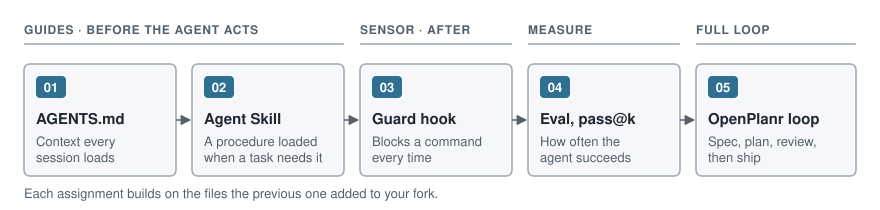

# agentic-practice

Assignments for the Astudylab Agentic Engineering course. You fork this
repository and change how a coding agent works in it: what it reads, what it
may run, how you measure it, and how a feature goes from spec to merge. You
use your own agent: Claude Code, Codex or Cursor.

The codebase is **tally**, a small TypeScript library and CLI that records
shared expenses and works out who pays whom. It has rules an agent gets wrong
without context: money is an integer count of minor units, each currency has
its own number of decimals, uneven splits hand out the remainder one unit at a
time in member order, and the same ledger always settles to the same transfers.

```console
$ node src/cli.ts settle fixtures/lisbon-trip.csv
ben pays chloe 286.67 EUR
ana pays chloe 76.67 EUR
ana pays dev 46.67 EUR
```



## Assignments

| # | Assignment | Skill | Time | What is checked |
| --- | --- | --- | --- | --- |
| 01 | [AGENTS.md for tally](assignments/01-agents-md/README.md) | Context engineering | 90 min | File at the root, under 8 KiB, every `npm run` script it names exists, `CLAUDE.md` imports it if present |
| 02 | [An Agent Skill that adds a currency](assignments/02-agent-skill/README.md) | Guides (skills) | 2 h | `SKILL.md` follows the Agent Skills specification; JPY and KWD added with it, with passing tests |
| 03 | [A hook that blocks dangerous commands](assignments/03-guard-hook/README.md) | Sensors (hooks) | 2 h | Registered as a `PreToolUse` hook on `Bash`; blocks every payload in `fixtures/hook-payloads/blocked/` with exit 2, allows the rest silently |
| 04 | [An eval with pass@k reporting](assignments/04-eval-pass-at-k/README.md) | Proving it works | 3 h | At least 6 tasks with code graders, 5 trials each; estimators pass unit tests; the committed report matches one recomputed from the runs |
| 05 | [One OpenPlanr spec-to-ship loop](assignments/05-openplanr-loop/README.md) | The full loop | 3 h | Spec, story and tasks committed before the implementation; `settle --format csv` passes its acceptance tests |

Do them in order. Each one builds on the files the previous one added. A mentor
reviews every pull request; the README of each assignment says what they read.

## Start here

1. Fork this repository and clone your fork.
2. Enable GitHub Actions on your fork's Actions tab. Without this step your
   pull requests get no checks.
3. Use Node 24 (`.nvmrc`), then run `npm ci` and `npm run check`.
4. Read [docs/git-workflow.md](docs/git-workflow.md) for branch and pull
   request names, then open [assignment 01](assignments/01-agents-md/README.md).
   If the "Pull request contract" step fails on a title, edit the title of the
   open pull request; that re-runs the check.

## Commands

| Command | What it does |
| --- | --- |
| `npm run check` | Lint, typecheck, unit tests and the verified-commands check |
| `npm run check:assignment` | The acceptance test for the assignment your branch names |
| `npm run check:assignment -- 03` | The acceptance test for one assignment, from any branch |
| `node src/cli.ts settle <ledger.csv>` | Transfers that settle a ledger |
| `node src/cli.ts balances <ledger.csv>` | Each member's net balance |

Node 24 runs the `.ts` files directly; there is no build step. Every command
the assignments ask you to run in another tool is listed with its source and
the date it was checked in [docs/verified-commands.md](docs/verified-commands.md).

## License

MIT. See [LICENSE](LICENSE).
