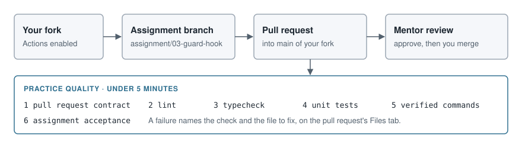

# Git workflow

You work in your own fork. Each assignment is one branch and one pull request
into your fork's `main`. Your mentor reviews the pull request; you merge it
after approval. Your progress is recorded in Astudylab, not in this repository.



## Set up once

1. Fork `TechArc-io/agentic-practice` on GitHub and clone your fork.
2. Enable GitHub Actions on your fork's Actions tab. Workflows do not run in a
   fork until you do, so skip this and your pull requests get no checks.
3. Add the upstream repository so you can take later fixes:

   ```bash
   git remote add upstream https://github.com/TechArc-io/agentic-practice.git
   ```

4. Install dependencies with Node 24 (the version is in `.nvmrc`) and confirm the
   starter passes:

   ```bash
   npm ci
   npm run check
   ```

## Branch and pull request names

| What | Rule | Example |
| --- | --- | --- |
| Branch | `assignment/<id>`, optionally followed by `-<suffix>` | `assignment/03-guard-hook` |
| Pull request base | `main` of your fork | `main` |
| Pull request title | `<type>(<id>): <summary>`, at most 72 characters, no trailing period | `feat(03-guard-hook): block destructive git and rm commands` |

`<id>` is the assignment folder name, such as `01-agents-md`. `<type>` is one of
`feat`, `fix`, `docs`, `test`, `refactor` or `chore`. Editing the title of an open
pull request re-runs the check.

## One assignment

```bash
git switch main
git switch -c assignment/03-guard-hook
# work, commit
npm run check
npm run check:assignment
git diff --check main...HEAD
git push -u origin assignment/03-guard-hook
```

`npm run check:assignment` finds the assignment from the branch name. To run
another assignment's acceptance test, pass its number:
`npm run check:assignment -- 04`.

`git diff --check main...HEAD` reports trailing whitespace and conflict markers
in what your branch changed since it left `main`, not in files you have not
committed yet.

Later assignments build on earlier ones, so merge each approved pull request
before you start the next branch.

## Take upstream fixes

Sync with a merge. Your `main` holds your merged work, so a fast-forward-only
pull fails once upstream moves.

```bash
git fetch upstream
git switch main
git merge upstream/main
git push origin main
```

If you are mid-assignment, merge `main` into your branch afterwards.
